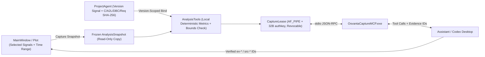

# CATK

> **CAN/LIN Automotive Telemetry & Bus Log Analyzer** — a portable, zero-install Windows application for loading CAN/LIN measurements, decoding bus & cloud telemetry logs, inspecting raw frames, and running evidence-backed signal analysis.
>
> Maintained fork of [Osvanta Bus Log Analyzer](https://github.com/osvanta/bus-log-analyzer) (`MPL-2.0`).


---

## Why CATK

CATK builds on the upstream `BLF / ASC / TRC / MDF4 / CSV` decoding & plotting core and adds three engineering workflows built for real vehicle calibration and cloud-telemetry triage:

1. **Compact Multi-Window Offline Observation** ([reference](docs/offline-observation.md))
   - CANape-style compact multi-window graphs with per-window light signal legends (`信号 / C1 / C2` column header on the top window only), unit-only Y axes (`共轴` or `独立轴` per window), linked dual cursors, and a shared draggable bottom time ruler (wheel zoom down to 10 ms and finer intervals).
   - Integer-pixel line widths (`1`, `2`, `3`, `4`, `5`, `6`, `8 px` or `Auto`), adaptive original sample point inspection (`稀疏显示，放大查看全部` → `全量（当前视图）`), drag-and-drop signal moves across windows, **Exact-Name Signal Inheritance** across log switches, and reusable project **Analysis Templates**.

2. **Project Profiles, Cloud CSV → Self-Contained Playback BLF & Freshness**
   - **Reusable Project Profiles** (`File ▸ Open/Save project`, `File ▸ Project settings`) store DBC/LDF channel mappings, supplemental physical CSV sources (`{measurement_stem}.csv` + explicit UTC/wall-clock alignment), freshness defaults, and analysis templates separately from any recording.
   - **Cloud Telemetry BLF Reconstruction** (`File ▸ Save playback BLF…`): converts cloud-exported physical CSVs into single-file BLF logs carrying standard CAN/CAN-FD/LIN frame objects alongside `GLOBAL_MARKER` sparse/missing-observation records and SHA-256 locked DBC contracts — reopening needs no sidecar CSV or external DBC.
   - **Per-signal Freshness (`Stale after`) & Clock Modes**: explicitly switches display between `BLF UTC → local` and `Cloud local wall time` (preventing double timezone shifts on cloud-converted BLFs), while shading stale intervals and reporting `Stale` / `No data` instead of silently holding outdated samples.
   - **Log Explorer**: project-rooted folder browser with background copy/paste/ZIP compress/extract (ZipSlip-safe) and Recycle Bin delete, plus floating **Signals** window.

3. **Bounded Local & Agentic Analysis Assistant (with `ProjectAgent` Traceability)**
   - **Local Deterministic Analyzer**: computes stats, largest single-step jumps, constant intervals, and sampling-interval anomalies on the selected signal/cursor window off the GUI thread, emitting clickable evidence rows that jump the plot directly to the event.
   - **Revocable Named-Pipe Capture MCP & Project Reference Lookup**: shares only a frozen read-only `AnalysisSnapshot` over an authenticated local Windows pipe (`CaptureLease`, 32-byte `authkey`, revocable at any time via `撤销取数`), optionally bound to a version-scoped **ProjectAgent** (`assistant-project-agents.json`) that matches the logged software version signal and exposes C/A2L/DBC/requirement search via `osvanta_lookup_reference`. Only locally issued `ev-*` / `src-*` IDs can become navigable links back to waveforms or source excerpts.



---

## Supported formats

| Measurement | Content | Database |
|---|---|---|
| BLF (`.blf`) | Raw CAN/LIN frames or CATK cloud playback BLF | DBC / ARXML / LDF (embedded in cloud BLF) |
| ASC (`.asc`) | Raw CAN frames | DBC or ARXML required |
| TRC (`.trc`) | Raw CAN frames (PEAK trace, versions 1.0 to 3.0) | DBC or ARXML required |
| MDF4/MDF3 (`.mf4`, `.mdf`) | Raw CAN bus logging or pre-decoded signals | Required only for raw bus logging |
| CSV (`.csv`) | Raw CAN export, narrow/wide signals, or cloud CSV | Required for raw CAN / cloud import |

MDF and CSV content is detected automatically. Database Manager supports per-channel DBC/ARXML/LDF assignments, mixed database formats, decode-coverage indicators, and a channel-0 fallback.

---

## Core capabilities

- Fast bulk loading and decoding for BLF, ASC, TRC, MDF/MF4, and CSV measurements.
- Searchable channel/message/signal tree with multi-select plotting, drag-and-drop across windows, and exact-name signal inheritance when switching logs.
- Indexed **Trace** of raw CAN and LIN frames with filtering, on-demand decode, **Δt** per ID/channel, changed-byte highlighting, and bidirectional Cursor 1 sync.
- Formula-based **Calculated Signal** with arithmetic, comparisons, logical expressions, temporal operations, and stateful diagnostic counters (**Insert function** `Shift+F3`).
- **Statistics** in the signal table (`Min`, `Max`, `Mean`, `Std dev`, `RMS`, `Samples`, `Δ C2−C1`) over the visible range or between cursors.
- **Table** view beside the plot, named **Markers** (`M`) exported as MF4 events, **Measurement info** (`Ctrl+I`), and export to CSV, Excel (`.xlsx`), or MF4 (**Save decoded measurement as MF4**).
- **Tools ▸ Convert files**: join, cut, resample, filter signals, and convert between BLF, ASC, MF4, and CSV (TRC input).
- **Plot modes**: **Stacked** (default), **Multi-Axis** (unit-grouped or per-signal axes), **MultiStack** (overlay lanes), and **Multi-Window** (`多窗口` with independent per-window legends and `共轴`/`独立轴` modes).
- **Line & point modes**: **Step Mode** (default) or **Interpolation Mode** (`S`), adaptive **Show Data Points**, **Hide Line**, and explicit line widths (`1–8 px` or `Auto`).

---

## Install and run

### Portable release (Windows)

Download the latest Windows ZIP from [Releases](https://github.com/jintaotian460-Tony/CATK/releases), extract it, and run `BusLogAnalyzer.exe` (or `BusLogAnalyzer.exe --config session.json`). No Python installation is required.

> **Bring your own databases:** DBC/ARXML/LDF databases, recorded vehicle data, and personal project profiles are never included in this repository or in release packages.

### From source

```powershell
git clone https://github.com/jintaotian460-Tony/CATK.git
cd CATK
python -m venv .venv
.\.venv\Scripts\Activate.ps1
python -m pip install -r requirements.txt
python app.py
```

The portable build and CI release build target Python 3.12 on Windows.

---

## Basic workflow

1. Select **Open Measurement** (`Ctrl+O`) and choose a supported measurement, or double-click a file in **Log Explorer**.
2. If the file contains raw CAN/LIN frames, select **Databases** and configure DBC/ARXML/LDF mapping (or configure a reusable project under **File ▸ Project settings**).
3. Select **Decode** (`F9`).
4. Double-click, drag, press `Space`, or use the context menu to plot signals into the active window.
5. Drag the bottom time ruler to pan, scroll to zoom down to 10 ms or finer, and click / Shift+click for Cursor 1 / Cursor 2 readouts.
6. Open **Assistant** to run local deterministic signal checks or bind a `ProjectAgent` catalog (`assistant-project-agents.json`) for version-scoped C/A2L/DBC/requirement lookup with Codex Desktop.
7. Use **File ▸ Save configuration** (`Ctrl+S`), **File ▸ Save project**, **分析模板**, or **File ▸ Export plotted signals** (`Ctrl+E`).

---

## Keyboard shortcuts

| Key | Action |
|---|---|
| `F1` | Getting started, in the user guide |
| `Ctrl+O` | Open Measurement |
| `F9` | Decode |
| `Ctrl+S` | Save configuration |
| `Ctrl+E` | Export plotted signals |
| `Ctrl+I` | Measurement info |
| `Ctrl+Shift+R` | Open the Trace |
| `Shift+F3` | Insert function, in Calculated Signal |
| `F` | Fit X and Y to all visible data |
| `V` | Fit Y to the current X range |
| `Z` / `Esc` | Rectangle Zoom on or off / leave it |
| `S` | Step Mode or Interpolation Mode |
| `Space` | Plot selected signal-tree entries |
| `C` | Change the selected signal color |
| `R` | Toggle both cursors |
| `M` | Add a marker at Cursor 1 |
| `Delete` | Remove selected plotted signals |
| `Ctrl+Z` | Undo the last plot or window action |
| `Ctrl+Shift+-` / `Ctrl+Shift++` | Collapse / expand signal-tree messages |

---

## Test and build

```powershell
python -m pip install -r requirements.txt -r requirements-dev.txt
python -m pytest
```

Build the portable application with:

```powershell
.\build_portable.bat
```

Output is written to `dist\BusLogAnalyzer\`. Runtime dependencies are maintained in [requirements.txt](requirements.txt) and hash-pinned in [requirements-release.txt](requirements-release.txt).

---

## Repository layout

```text
app.py                         Application entry point and version
core/readers/                  BLF, ASC, TRC, MDF/MF4, and CSV readers
core/                          Decode, signal store, cloud BLF, project config, templates,
                               analysis snapshot/tools, ProjectAgent, CaptureLease, RPC transport
gui/                           Main window, multi-window plots, Log Explorer, Assistant dock,
                               Database Manager, CAN Trace, Project settings
tools/osvanta_capture_mcp.py   Stdio MCP bridge to revocable CaptureLease pipes
docs/                          Offline observation reference and architecture notes
guide/, mkdocs.yml             User guide source
resources/                     Application icon and splash assets
tests/                         Pytest regression suite
```

---

## Security, license, and attribution

- Release binaries are currently unsigned, so Windows SmartScreen may show a warning on first launch.
- CATK stores per-user packaged settings and caches under `%LOCALAPPDATA%\CATK\` (with automatic non-destructive seeding from earlier `%LOCALAPPDATA%\Osvanta\BusLogAnalyzer\` installations on first run).
- Licensed under the [Mozilla Public License 2.0](LICENSE). Based on **Osvanta Bus Log Analyzer** by Dinakaran Ganesan (`MPL-2.0`; releases up to `v00.00.59` under [LICENSE-MIT](LICENSE-MIT)).
- Bundles third-party components under their own licenses, including LGPL-3.0 components (Qt via PySide6, python-can, asammdf, chardet). See [THIRD_PARTY_NOTICES.md](THIRD_PARTY_NOTICES.md) and `licenses/`.
- `"Osvanta"` and `"Osvanta Bus Log Analyzer"` are trademarks/names of the upstream project; CATK maintains its own name and branding.
